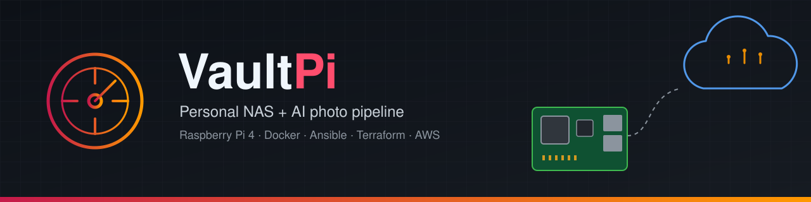
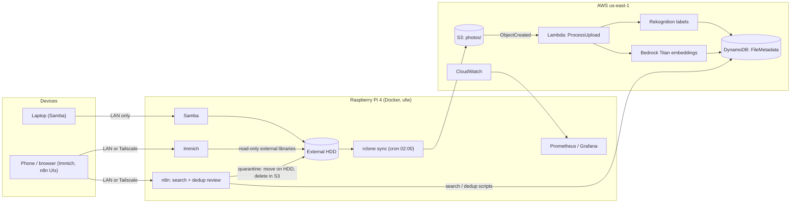
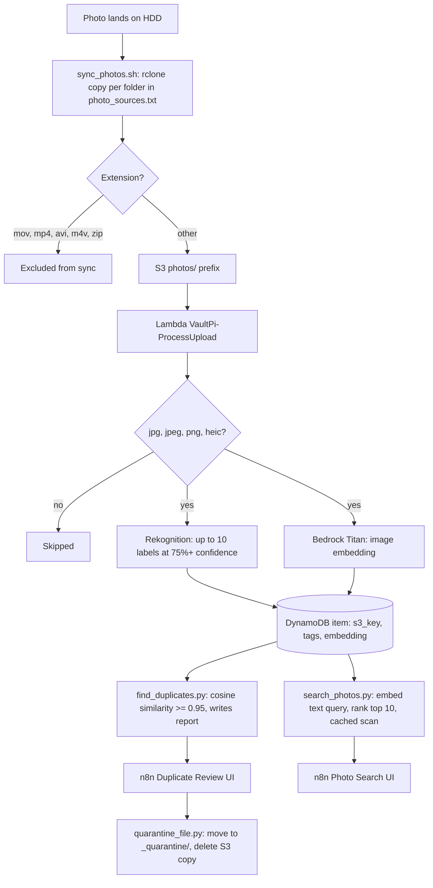
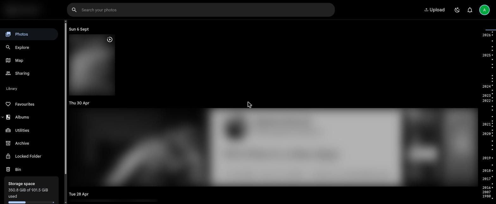
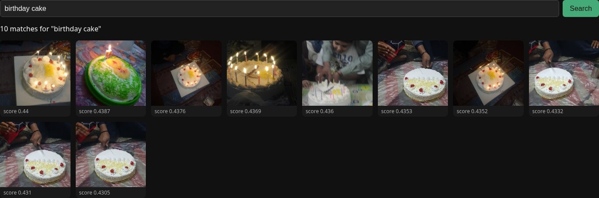
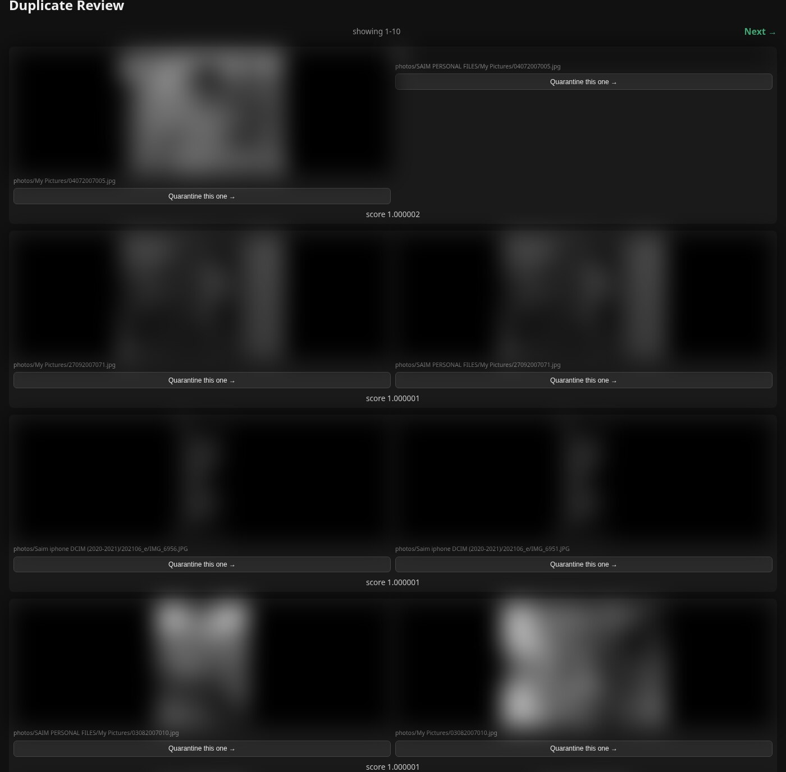
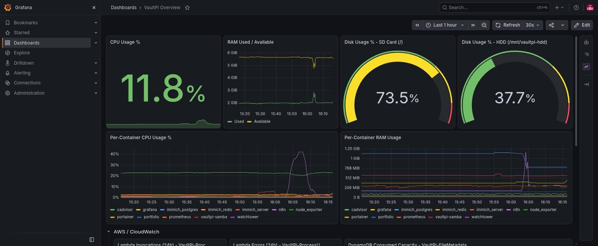

<p align="center">
  
</p>

<p align="center">
  
  
  
  
  
  
  
  
  
  
  
  
  
</p>

# VaultPi

**A self-hosted NAS and AI photo pipeline on a Raspberry Pi 4 and AWS, provisioned end to end with Ansible and Terraform.**

Photos live local-first on an external HDD, are served over Samba and Immich, and sync nightly to S3. Each upload triggers a Lambda that tags the image with Rekognition and embeds it with Bedrock Titan; the results land in DynamoDB and power near-duplicate detection and natural-language photo search. Everything on the Pi runs in Docker, is reachable only from the LAN or a Tailscale tailnet, and is rebuilt from the playbook rather than by hand.

## Why

- A Windows partition was eating ~1TB of laptop storage for two games — couldn't reclaim it without losing a "Google Drive" of my own.
- No real NAS existed — photos and files just piled up locally, no dedup, no tagging, no backup.
- The Pi 4 (8GB) was already running Portainer, n8n, and a personal site 24/7 — spare capacity going to waste.
- An external HDD had been written off as "too slow" — irrelevant for archival/backup use.

So: idle Pi + "useless" HDD → a NAS with AI photo tagging, near-duplicate detection, and natural-language search, backed up to S3 instead of one SD card.

## Architecture



### Photo pipeline



## Key decisions

- **One Pi, no redundant second Pi.** Accepted single point of failure on purpose, to force real lessons in resource contention on constrained hardware. Mitigated with a weekly backup of Docker configs + n8n data to S3.
- **Bedrock Titan, not self-hosted CLIP.** One managed `InvokeModel` call handles both image and text embeddings — no model to host, version, or package into a Lambda container.
- **Samba never touches the public tunnel.** The Pi is already internet-facing (Cloudflare Tunnel, for the website) — file-sharing stays strictly LAN-only instead of reusing that path.
- **Hybrid storage tiering.** Files stay local on the HDD first (fast, private, free), then sync to S3 for AI processing and offsite backup, with a Glacier lifecycle rule planned for cold data.

## Security model

Everything below is what the code in this repo actually does.

- **Secrets stay out of git.** `ansible/vault_vars.yml` is committed only in `ansible-vault` encrypted form; `ansible/vault_vars.yml.example` documents the keys with no values. The vault password lives outside the repo (`vault_password_file = ~/.vaultpi-vault-pass` in `ansible.cfg`). Service `.env` files are templated onto the Pi from vault values, and the Discord webhook file likewise.
- **Network exposure.** No service is intended for the public internet. Immich (2283) and n8n (5678) get `ufw` rules from the playbook: allow from the LAN subnet and the Tailscale CGNAT range (`100.64.0.0/10`), then deny from everywhere else. Samba (445) is LAN-only by design and is never routed through any tunnel. Remote access is via Tailscale, installed by the `tailscale` role.
- **Authenticated writes.** The n8n quarantine webhook (which moves and deletes files) requires a `?token=` secret from the vault. Photo Search and Duplicate Review are plain HTML with no login: "on the LAN or tailnet" is their auth model.
- **AWS side.** The S3 bucket blocks all public access and uses AES256 server-side encryption. DynamoDB has point-in-time recovery and deletion protection. Grafana reads CloudWatch through a dedicated read-only IAM user.
- **Container hygiene.** Everything runs in Docker for isolation and reproducibility; Immich's external libraries are mounted read-only; Watchtower keeps images updated and reports to Discord.
- **Known limitations.** The Lambda role uses broad AWS managed policies (S3 read-only, DynamoDB/Rekognition/Bedrock full access), which should be scoped down. Grafana (3001), Prometheus (9090), cAdvisor (8080) and node_exporter (9100) are published by Docker without ufw rules in this repo, and Docker-published ports can bypass ufw, so they rely on the home network boundary.
- **Cloudflare Tunnel.** The author's personal website reaches the internet through a Cloudflare Tunnel on the same Pi. That tunnel is configured outside this repo, and nothing here routes through it.

## Services

| Service | Purpose | Port | Exposure |
| --- | --- | --- | --- |
| Samba (`dperson/samba`) | SMB share of the HDD | 445 | LAN only |
| Immich | Photo library UI and phone upload (built-in AI disabled; Bedrock does that) | 2283 | ufw: LAN + Tailscale |
| n8n (custom image, pinned 1.106.3) | Photo Search and Duplicate Review webhooks, quarantine workflow | 5678 | ufw: LAN + Tailscale |
| Grafana | VaultPi Overview dashboard, alert rules, CloudWatch datasource | 3001 | published by Docker, login required |
| Prometheus | Metrics store | 9090 | published by Docker |
| node_exporter, cAdvisor | Host and per-container metrics | 9100, 8080 | published by Docker |
| Watchtower | Container image updates, Discord notifications | none | internal |
| Avahi | `anakafeel-pi.local` mDNS name | mDNS | LAN |
| Tailscale | Remote access to the above | n/a | tailnet |

## Using it

Connect first, either way:

- **LAN:** `anakafeel-pi.local` (mDNS via avahi — survives DHCP/router changes).
- **Tailscale:** install the app, log into the tailnet, then use the Pi's tailnet address (or MagicDNS name) with the same ports as on the LAN.

**Immich** — browse the photo library / upload from phone
- App or browser → tailnet address on port 2283 (Tailscale) / `http://anakafeel-pi.local:2283` (LAN)
- Reads existing photo folders in place, read-only. Smart search / facial recognition are off on purpose — that's what the Bedrock pipeline is for.



**Photo Search** — describe a photo, get matches
- `http://anakafeel-pi.local:5678/webhook/photo-search`
- Type a description ("birthday cake", "dog at the beach"), hit Search.
- First query after a 6h-stale cache: ~55-60s (full table scan). After that: a few seconds.
- Bookmark it to your phone's home screen — opens full-screen, feels like a lightweight app.



**Duplicate Review** — clean up near-duplicates
- `http://anakafeel-pi.local:5678/webhook/duplicate-review`
- 10 pairs per page, `← Previous` / `Next →` via `?offset=`.
- "Quarantine this one" moves the file to `_quarantine/` on the HDD and deletes its S3 copy. The auth token the webhook now requires is attached automatically — just click.


*(Photos blurred on purpose — real near-duplicate pairs, mostly identifiable family photos. UI, scores, and buttons are real and unedited.)*

**Grafana** — VaultPi Overview dashboard
- `http://anakafeel-pi.local:3001` — login required.
- Pi + per-container CPU/RAM/disk, plus CloudWatch metrics (Lambda, DynamoDB, S3). Disk alerts fire to Discord before a mount fills up.



**Don't expect too much:**
- Photo Search / Duplicate Review are unauthenticated plain HTML — "on the LAN or tailnet" *is* the auth model.
- No offline support, no native mobile app beyond a home-screen bookmark.
- A workflow failing mid-run (n8n restart, bad path) gets you a blank page, not a friendly error.
- What does work: search results are genuinely useful, dedup catches real duplicates, and quarantine + S3 backup make a bad click recoverable.

## Lessons learned

- **Dedup found organizational debt, not just accidental copies.** ~14,800 embeddings → ~11,400 candidate duplicate pairs, but the big clusters were whole folders copied wholesale (`My Pictures` mirrored into `SAIM PERSONAL FILES`, overlapping iPhone DCIM folders, a Note 8 `DCIM`/`DCIM (1)` conflict) — not isolated re-saves.
- **Raw object counts lie.** Assumed ~73,700 objects under the photos prefix; the real eligible-image count (JPEG/PNG/HEIC only, after excluding `.aae`/`.dng`/`.cr2`/etc.) was ~14,800 — a fifth of that. Compute the filtered count up front next time.
- **Video was excluded from day one.** Rekognition and Bedrock embeddings are photo-only, and video files are too large to justify processing for no dedup/search benefit — `.mov`/`.mp4`/`.avi`/`.m4v` are skipped by the sync script.

## Repo structure

```
.
├── ansible/                 playbook.yml, inventory.ini, ansible.cfg, group_vars/, vault_vars.yml (encrypted)
│   └── roles/               avahi, tailscale, hdd_mount, docker, immich, n8n, watchtower,
│                            samba, monitoring, scripts, cron_jobs
├── terraform/               S3, DynamoDB, Lambda, IAM (variables.tf, outputs.tf, ...)
├── lambda/process_upload/   S3-triggered Lambda: Rekognition + Bedrock Titan -> DynamoDB
├── pi-configs/              docker-compose per service: immich, n8n, samba, monitoring, watchtower
├── scripts/                 sync, backfill, dedup, search, quarantine, presign, backup, prune
├── config/photo_sources.txt folders under the HDD that sync_photos.sh uploads
└── docs/screenshots/        real screenshots of the running system
```

## Deploy

Prerequisites: a Raspberry Pi running Raspberry Pi OS (Debian) reachable over SSH, an external HDD and a second ext4 SD card for Docker's data-root, an AWS account with Bedrock Titan image-embedding model access enabled, and Terraform, Ansible and rclone installed. The repo describes the author's hardware, so adjust the values below to your own.

**1. AWS (Terraform).** The configuration was written against infrastructure that already existed, so on an account that already has the resources use `terraform import`; on a fresh account `apply` creates them.

```bash
cd terraform
terraform init
terraform plan -var s3_bucket_name=<your-unique-bucket> -var aws_account_id=<your-account-id>
terraform apply -var s3_bucket_name=<your-unique-bucket> -var aws_account_id=<your-account-id>
```

Variables (`variables.tf`): `aws_region` (default `us-east-1`), `aws_account_id`, `s3_bucket_name`. Outputs: bucket name/ARN, Lambda name/ARN, DynamoDB table name/ARN, Lambda role ARN, and the Grafana CloudWatch IAM user ARN. Terraform does not create access keys for that IAM user; create one yourself and put it in the vault. The bucket name is also hardcoded in `scripts/` and `pi-configs/`, so search for `saim-vaultpi-files` if you rename it.

**2. Pi prerequisites (manual).** Configure an rclone remote named `vaultpi-s3` and AWS credentials for the Pi user; the playbook does not set these up. Install the Python dependencies used by the scripts (`boto3`, `numpy`, and for backfill `pillow`, `pillow-heif`).

**3. Vault.**

```bash
cd ansible
cp vault_vars.yml.example vault_vars.yml     # fill in real values
ansible-vault encrypt vault_vars.yml
echo '<vault password>' > ~/.vaultpi-vault-pass && chmod 600 ~/.vaultpi-vault-pass
```

Required keys: Samba user/password, Discord webhook id/token, Grafana CloudWatch access key pair, Immich DB password and admin credentials, n8n owner credentials, and the quarantine webhook token.

**4. Inventory and variables.** Point `ansible/inventory.ini` (group `[vaultpi]`) at your Pi, and edit `ansible/group_vars/all.yml`: `hdd_uuid`, `docker_root_uuid`, `lan_subnet`, `vaultpi_user`/paths, and `immich_external_library_folders`. Match `config/photo_sources.txt` to your HDD folders.

**5. Run the playbook.**

```bash
cd ansible
ansible-playbook playbook.yml --syntax-check
ansible-playbook playbook.yml
```

Roles run in this order: `avahi`, `tailscale`, `hdd_mount`, `docker`, `immich`, `n8n`, `watchtower`, `samba`, `monitoring`, `scripts`, `cron_jobs`. `hdd_mount` precedes `docker` on purpose, so Docker's first start uses the dedicated data-root mount.

**6. Authenticate Tailscale (one-time, manual).** The role installs Tailscale but deliberately does not automate login:

```bash
sudo tailscale up --hostname=anakafeel-pi
```

**Verification status.** This guide was checked by reading `playbook.yml`, `inventory.ini`, `ansible.cfg`, the Terraform files and the scripts. Neither `terraform` nor `ansible-playbook` was available when this README was written, so `terraform fmt -check` and `--syntax-check` were not run, and nothing was deployed.

## Operations

| Job | Schedule (cron, Pi user) | What it does |
| --- | --- | --- |
| `sync_photos.sh` | Daily 02:00 | `rclone copy` each folder in `config/photo_sources.txt` to `s3://<bucket>/photos/`, skipping video and zip files |
| `prune_and_notify.sh` | Sundays 03:00 | `docker system prune -af --volumes=false`, logs reclaimed space and disk usage, posts a summary to Discord |
| `backup_pi_config.sh` | Sundays 04:00 | Archives compose configs and the n8n data volume, uploads to `s3://<bucket>/pi-config-backup/`, keeps the last 4 local copies |

- **Backups.** Photos are protected by the S3 sync; Pi configuration and n8n workflows by the weekly config backup. The Pi remains a single point of failure by design.
- **Deduplication.** `find_duplicates.py` scans embeddings and writes a report of pairs with cosine similarity of at least 0.95. Review them in the n8n Duplicate Review page; `quarantine_file.py` moves the chosen file to `_quarantine/` on the HDD and deletes its S3 copy, logging each action.
- **Backfill.** `backfill_embeddings.py` processes existing S3 photos with a checkpoint file and 4 workers, resizing to the 2048px Titan limit.
- **Monitoring.** Grafana alert rules fire when docker-root or root disk exceeds 85% or the HDD exceeds 90%, notifying Discord. `hdd_mount` also installs a boot-time check so Docker does not start until the real HDD is mounted.
- **Presigned links.** `generate_presigned_url.py` creates 1-hour links for viewing search and dedup results.

## Roadmap

- S3 lifecycle rule to move cold data to Glacier (planned, not yet implemented).
- Replace the pasted-in-console Lambda deploy (Terraform currently ignores code changes) with a CI/CD pipeline.
- Re-test n8n `:latest` once the upstream ARM64 crash noted in `pi-configs/n8n/Dockerfile` is fixed.

## Author

**Saim Hashmi**, 4th-year Computer Systems Engineering student at Carleton University. GitHub: [@anakafeel](https://github.com/anakafeel).
